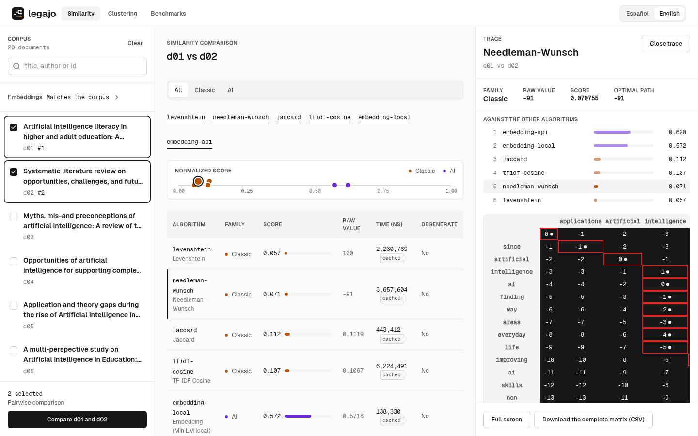
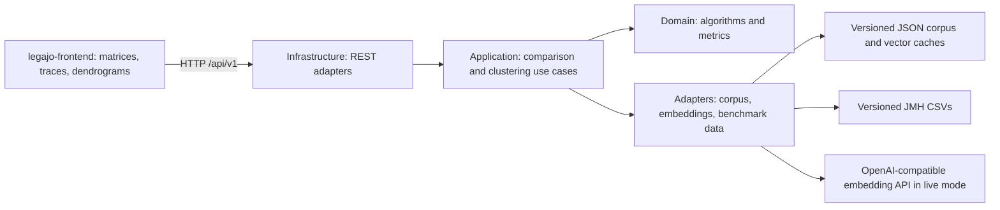

<!-- markdownlint-disable-next-line MD041 -->
<div align="center">

<h1>Legajo · API</h1>

<p><strong>Inspectable similarity scores and hierarchical clusters for students comparing research abstracts.</strong></p>

<p>
<a href="https://github.com/diegnghtmr/legajo-backend/actions/workflows/backend.yml"></a>


<a href="LICENSE"></a>
</p>

<p>
<a href="https://diegnghtmr.me/en/work/legajo/"><strong>Case study</strong></a> &bull;
<a href="#quick-start"><strong>Quick start</strong></a> &bull;
<a href="#architecture"><strong>Architecture</strong></a> &bull;
<a href="https://github.com/diegnghtmr/legajo-frontend"><strong>Frontend repo</strong></a>
</p>

</div>

<p align="center"></p>

<p align="center"><em>The API computes both the scores and the alignment trace rendered by the web app.</em></p>

Counting shared terms, aligning sequences, and comparing embeddings can give different answers about the same two abstracts. Legajo exposes those answers and the intermediate steps behind them through one API. It also lets the companion app compare how four linkage choices group the same reference corpus.

## Features

- **Six similarity capabilities.** Compare abstracts with Levenshtein, Needleman–Wunsch, Jaccard, TF-IDF cosine, local embeddings, or API-model embeddings.
- **Algorithm traces.** Inspect the steps behind a score, such as the optimal alignment path for Needleman–Wunsch.
- **Four linkages.** Build single, complete, average, or Ward dendrograms with a shared Lance–Williams engine and cut a tree into `k` clusters.
- **Evaluation metrics.** Compare cophenetic correlation, mean silhouette, and Davies–Bouldin values.
- **Versioned corpus and embeddings.** Serve 20 reviewed abstracts and precomputed vectors without embedding API credentials in the default setup.
- **Benchmark data.** Serve checked-in JMH runtimes and slopes over `GET /api/v1/benchmarks`, without rerunning JMH at request time.

## Quick start

Install Git, Docker, and Docker Compose. Java and Gradle are pinned for the container workflow; host installations are only for IDE support, not builds or tests.

```sh
git clone https://github.com/diegnghtmr/legajo-backend.git
cd legajo-backend
docker compose up -d --build --wait backend
```

Open <http://localhost:8080/actuator/health>. To run both services, clone the frontend as a sibling, then start Compose from this backend checkout:

```sh
git clone https://github.com/diegnghtmr/legajo-frontend.git ../legajo-frontend
LEGAJO_FRONTEND_DIR=../legajo-frontend docker compose up -d --build --wait
```

Open <http://localhost>. Compose waits for the image health checks: `/actuator/health` for the API and `/` for the web app. It starts the frontend only after the backend is healthy. Use `docker compose down` to stop the stack or `docker build -t legajo-backend:local .` to build only the API image. The `ingest` profile adds GROBID for offline extraction, not for demo use.

### Environment variables

Use `.env.example` as a reference. Keep secrets in your local environment or deployment secret store. Compose passes the embedding provider and allowed origins through to the backend; for other backend overrides, pass the variables to the application process or its container explicitly.

| Variable | Purpose | Default |
| --- | --- | --- |
| `LEGAJO_EMBEDDING_PROVIDER` | Use committed vectors (`cached`) or enable remote embedding calls (`live`). | `cached` |
| `LEGAJO_CORS_ORIGINS` | Comma-separated replacement list for `/api/v1/**`. | `http://localhost:5173` and `http://localhost` |
| `LEGAJO_PREPROCESS_STEMMING` | Apply Porter stemming to classic and TF-IDF inputs and report it in the response; embeddings are unaffected. | `false` |
| `SPRING_AI_OPENAI_BASE_URL`, `SPRING_AI_OPENAI_API_KEY` | Provider endpoint and credential for live mode and API precompute. | Supply for your provider |
| `LEGAJO_EMBEDDING_API_MODEL`, `LEGAJO_EMBEDDING_API_DIMENSION` | Model and vector length for live mode; set both explicitly for API precompute. | Runtime: `gemini-embedding-2-preview`, `1536` |
| `SPRING_AI_OPENAI_EMBEDDING_EMBEDDINGS_PATH` | API precompute warns on values other than the fixed `/embeddings` path; this is not an override. | Unset |
| `LEGAJO_GROBID_URL` | PDF extractor endpoint; `--grobid-url` takes precedence. | `http://localhost:8070` |
| `LEGAJO_FRONTEND_DIR`, `LEGAJO_FRONTEND_PORT` | Compose's frontend build context and host port. | `../frontend`, `80` |
| `VITE_API_BASE_URL` | Compose build argument for the browser-reachable API URL, not a container hostname. | `http://localhost:8080` |

### Deployment

The [API on Render](https://legajo-backend.onrender.com) runs this repository's Docker image and allows the [Vercel frontend origin](https://legajo-frontend.vercel.app) through CORS. The documented Render Git policy is `main`, auto-deploy after CI checks pass, and PR previews off; manual deploys remain possible. An idle instance can take tens of seconds to respond, so check `/actuator/health` before a walkthrough.

## Architecture

The [OpenAPI contract](docs/openapi-legajo.yaml) is the source of truth for the REST API and the companion TypeScript types. Each use case delegates the calculation to a framework-free domain. The infrastructure adapters handle PDF parsing, embedding inference or transport, JSON, and caching. `bootstrap` wires the modules into a Spring service.



### Conventions

Similarity, preprocessing, clustering, and metric calculations are hand-written; the dependencies handle extraction, model inference, and infrastructure. Preprocessing uses NFC normalization, lowercasing, tokenization, and English stopword removal. Needleman–Wunsch uses fixed `+1` match, `-1` mismatch, and `-1` gap scores; its backtrace breaks ties diagonal, up, then left. TF-IDF statistics use the whole corpus. Ward receives the doubled distance base from the shared merge engine, which breaks merge ties by the lexicographically first index pair. Architecture tests enforce the dependency boundaries.

### Ingestion and verification

The browser cannot ingest PDFs. The offline pipeline takes PDFs sorted by filename, extracts abstracts with GROBID and a PDFBox fallback, and writes an **unvalidated** corpus. Start the extractor and run ingestion from the backend root only when you intend to replace the output:

```sh
docker compose --profile ingest up -d grobid
LEGAJO_NETWORK_HOST=1 ./scripts/gradle-in-docker.sh :bootstrap:ingest --args='--input=data/pdfs --output=data/corpus.json --grobid-url=http://localhost:8070'
```

Wait until GROBID's `/api/isalive` returns `true` before ingesting. Host networking lets the Gradle container reach the published extractor port. Manually review titles, authors, and abstracts before validating the reviewed IDs:

```sh
./scripts/gradle-in-docker.sh :bootstrap:validateCorpus --args='--ids=d01,d02'
./scripts/gradle-in-docker.sh :bootstrap:verifyCorpus
```

Use `--all` only after reviewing every document. Validation freezes each reviewed `abstractSha256` and recomputes `corpusSha256`; verification reports all violations and exits non-zero if the corpus is invalid. Ingestion replaces the old corpus and clears validation; regenerate the caches with `:bootstrap:precomputeEmbeddings` and `:bootstrap:precomputeApiEmbeddings` before serving the new corpus in cached mode. The JSON corpus and vector caches are generated, not hand-edited; startup checks their `corpusSha256` binding. Stop the extractor with `docker compose --profile ingest stop grobid`.

## Tech stack

| Layer | Technology |
| --- | --- |
| Runtime and API | Java 25, Spring Boot 4.0.3, Springdoc OpenAPI |
| Data and inference | Jackson, PDFBox, GROBID, DJL tokenizers, ONNX Runtime, Spring AI |
| Build and checks | Gradle 9.2.1, JUnit 6, ArchUnit, JaCoCo, Docker |
| Benchmarks | JMH and versioned CSV exports |

## Testing

### Checks run in containers

```sh
./scripts/gradle-in-docker.sh build
./scripts/gradle-in-docker.sh test
./scripts/gradle-in-docker.sh jacocoRootReport
```

The wrapper uses the pinned Temurin image and a named Gradle cache. It does not expose the Docker socket unless you opt in with `LEGAJO_DOCKER_SOCKET=1`. [CI](.github/workflows/backend.yml) runs the containerized build, tests, and coverage report; the 85% line-coverage gate applies to similarity, clustering, and evaluation. Its image smoke job starts only the backend and checks health, OpenAPI, corpus access, a real comparison, Ward clustering, and CORS. The workflow includes the exact smoke command and unconditional teardown.

### Benchmarks

Run JMH and its CSV export in the same Gradle session on the reference machine:

```sh
./scripts/gradle-in-docker.sh :benchmarks:jmh :benchmarks:jmhExport
```

The protocol uses one fork, three one-second warmup iterations, and five one-second measurement iterations. It varies token sequence length for classic pairwise methods, vector count for clustering and internal metrics, and dimension for the embedding primitive; fixed-20-document checks bypass the similarity cache. The export records the machine and JDK in [jmh-results.csv](benchmarks/results/jmh-results.csv) and fits empirical log–log slopes against theoretical exponents in [slopes.csv](benchmarks/results/slopes.csv). It rejects unclassified rows and missing or mismatched harness metadata. The API serves these versioned files as-is and fails startup if either is missing or malformed. [The benchmark workflow](.github/workflows/benchmarks.yml) runs on manual dispatch or `bench-*` tags and uploads artifacts, not reference-machine numbers. A fast, non-representative Levenshtein smoke run is available by adding `-Pjmh.fork=1 -Pjmh.warmupIterations=1 -Pjmh.iterations=1 -Pjmh.includes=Levenshtein` to the `:benchmarks:jmh` invocation without the export task.

## Project structure

| Module | Purpose |
| --- | --- |
| `domain` | Similarity, preprocessing, clustering, metrics, corpus model, and ports; no Spring, Jackson, or DJL dependencies. |
| `application` | Use cases that orchestrate the domain. |
| `infrastructure` | REST, PDF, embedding, corpus, and cache adapters. |
| `bootstrap` | Spring startup, wiring, and one-shot corpus tools. |
| `benchmarks` | JMH harness and reference results. |

## Related repositories

- [legajo-frontend](https://github.com/diegnghtmr/legajo-frontend) — bilingual workbench for exploring scores, traces, trees, and benchmark curves.

## License

Released under the [MIT License](LICENSE).
